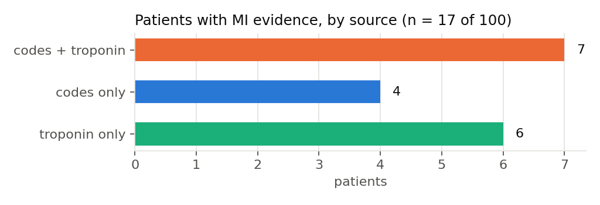
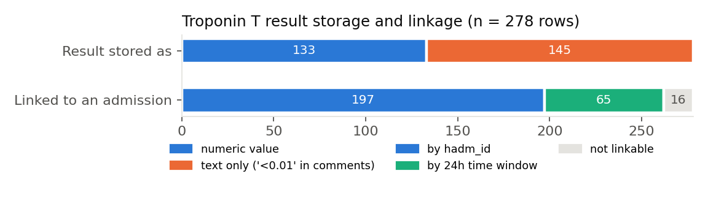
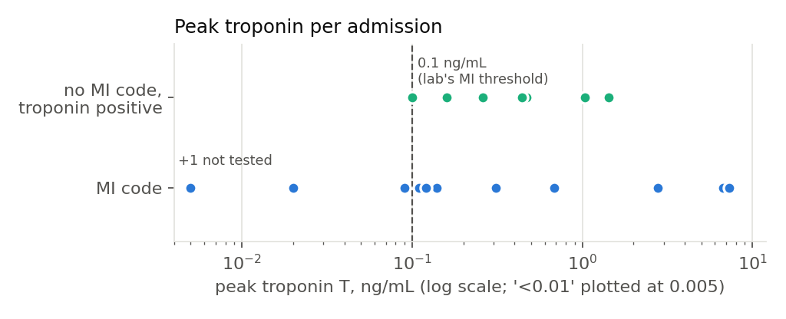

# Heart attack phenotype and data quality report

**Data:** MIMIC-IV Clinical Database Demo v2.2: real, de-identified records for 100 patients and 275 admissions at Beth Israel Deaconess Medical Center, Boston ([PhysioNet](https://physionet.org/content/mimic-iv-demo/2.2/), ODbL 1.0).
**Phenotype:** HDR UK Phenotype Library [PH1024](https://phenotypes.healthdatagateway.org/phenotypes/PH1024/version/2257/detail/), Acute Myocardial Infarction (George, Herrett, Smeeth), ICD-9 and ICD-10 components.
**Run:** `python -m hapdq.pipeline` (every number below is in `outputs/summary.json`).

---

## 1. Headline

**The count changes almost threefold depending on the rule: between 6 and 17 of the same 100 patients have had a heart attack.**

| Rule | MI patients |
|---|---|
| PH1024 code as the principal diagnosis | **6** |
| PH1024 code in any diagnosis position (the phenotype) | **11** |
| Peak troponin T ≥ 0.10 ng/mL in an admission | **13** |
| Either source | **17** |

Codes and troponin agree on only **7** patients. Codes alone find **4** more, and troponin alone finds **6** more.



## 2. The data quality findings that change the answer

The real data passes every structural check (duplicates, linkage, time order, ages, code validity, events after death; `outputs/dq_checks_real.csv`). The problems that matter are in how results are stored and linked, and a structural check suite on its own would miss them.

**2.1 Half the troponin results have no number.** In **145 of 278** troponin T rows (52%), `valuenum` is null. The result (`<0.01`, below detection) appears only in the free-text `comments` field. If you filter on `valuenum`, every negative test drops out, the troponin-negative group nearly disappears and the positive rate looks far higher than it is. The pipeline recovers these as 0 and flags them (`recovered_from_text`).

**2.2 Three in ten troponin rows are not linked to an admission.** **81 of 278** rows have no `hadm_id`. They are mostly the emergency department draw taken minutes or hours before formal admission. Linking them with a 24-hour pre-admission window attaches **65** of them and raises the number of admissions with a troponin test from **83 to 106** (+28%). In one coded MI admission the only troponin was an unlinked ED draw three minutes before admission. Under strict linkage that admission looks untested, but with the window it is tested and negative.



On this sample the window does not change the patient-level overlap in section 1, because the newly linked draws were negative or below an already-recorded peak. It does change the denominator for any "was the code confirmed by a test" statistic. `outputs/linkage_sensitivity.csv` reports both rules.

**2.3 The coding system changes partway through.** **152** admissions are coded in ICD-9 and **123** in ICD-10 (the US switched in October 2015). The phenotype needs both code lists. PH1024's hospital component is ICD-10 `I21` only. Its ICD-9 codes (`410`, `4110`, `4297`) and `I22`/`I23` come from the death-registration component. Applying them to hospital ICD-9 data is a documented adaptation (`phenotypes/mi_codelist.csv`). In practice, the only codes that matched in this sample were `I214` (NSTEMI) and `41071` (subendocardial infarction).

**2.4 Dates are shifted and death has no cause.** Each patient's dates are shifted into the years 2100 to 2200, so calendar trends can only use `anchor_year_group`. `dod` covers out-of-hospital deaths only up to a year after discharge and carries no cause of death, so a death-registration MI source (part of PH1024) cannot be built from MIMIC.

## 3. Codes vs troponin: what the disagreements are



- **Coded MI, troponin negative or missing (4 patients).** Of 12 coded admissions, 11 had a troponin (8 positive). The exceptions:
  - one was never tested;
  - one was just under the threshold (peak 0.09);
  - one ED draw read 0.02;
  - one admission had a principal diagnosis of NSTEMI while all **six** troponins were below detection. That fits an MI treated at another hospital before transfer, or a coding error. The record alone cannot tell which, so the case is flagged for review rather than resolved.
- **Troponin positive, no MI code (8 admissions; 6 of those patients never have an MI code).** The principal diagnoses were sepsis, aspiration pneumonitis, saddle pulmonary embolism with acute cor pulmonale, cardiogenic shock, acute respiratory failure (twice), atrial fibrillation and coronary atherosclerosis. Most are textbook causes of troponin release without a type 1 MI. Troponin is a comparator, not a gold standard. These cases show why phenotypes built on biomarkers alone over-count.

**Positive predictive value, roughly.** Of the 11 coded admissions that had a troponin test, **8 (73%)** were troponin-positive. Of the 16 troponin-positive admissions, **8 (50%)** carried an MI code. With n this small these are illustrative, not estimates.

**Outcome.** **3 of the 11** coded MI patients died within 30 days of their first coded MI admission.

## 4. Do the checks work? Planted vs found

Because the real data is clean structurally, a passing check proves little. A copy of the data was seeded with **29** known errors (`outputs/injected_errors_manifest.csv`, fixed seed). The check suite was then scored against them.

| Error planted | Planted | Found | Missed | False alarms |
|---|---|---|---|---|
| Duplicate patient record | 5 | 5 | 0 | 0 |
| Admission dated after death | 4 | 4 | 0 | 0 |
| Discharge before admission | 3 | 3 | 0 | 0 |
| Impossible or missing age | 3 | 3 | 0 | 0 |
| Malformed ICD code (dot, lower case, trailing space) | 6 | 6 | 0 | 0 |
| Look-alike characters in an ICD code (`R002` to `RO02`, `E785` to `E78Z`) | 3 | 3 | 0 | 0 |
| Diagnosis not linked to an admission | 5 | 5 | 0 | 0 |
| **Total** | **29** | **29** | **0** | **0** |

Two lessons came out of building this table:

1. **Format checks are not enough.** `E78Z` has the right shape for ICD-10 and passes the format rule. Only the dictionary lookup against `d_icd_diagnoses` catches it.
2. **The first version of the injector planted an error that was not an error.** Lower-casing a purely numeric ICD-9 code changes nothing. The scoring caught it as a "miss", and the injector was fixed. Without the planted-vs-found scoring, the bug would have gone unnoticed.

**Effect on the phenotype.** Three of the planted code errors deliberately hit MI codes.

| Dataset | MI patients |
|---|---|
| Real, as published | 11 |
| With planted errors | 10 |
| After cleaning | 11 |

Only one of the three corrupted MI codes (`i214`) was lost. Prefix matching still caught `I21.4` and `I214 `, which shows prefix matching is accidentally robust to some typos. An exact-match phenotype would have lost all three. Cleaning repairs case, whitespace and dots. It quarantines anything it cannot repair unambiguously, never guesses, and cascades the quarantine to child rows (`outputs/quarantine_log.csv`). After cleaning, the true count is restored.

## 5. Limitations

- **100 patients.** Every count here is small and the demo is not a representative sample. The full MIMIC-IV (around 300,000 patients) needs credentialed access and was not used; the pipeline would run on it by pointing `--data` at its `hosp/` folder.
- **One hospital, hospital data only.** There is no primary care (GP) record and no cause of death, so two of PH1024's three sources cannot be reproduced. In NHS terms this is HES without GPES or ONS deaths.
- **Troponin assay.** The data has troponin T (itemid 51003) with the lab's own 0.10 ng/mL MI threshold, not a high-sensitivity assay with sex-specific 99th percentiles. The demo has no troponin I rows (itemids 51002, 52642).
- **Billing codes.** ICD codes in MIMIC are assigned for billing, and position reflects billing priority.
- **US coding.** ICD-9-CM and ICD-10-CM differ from the WHO ICD-10 used in HES and from ICD-10-AM used in Ireland's HIPE. The MI codes (`I21`/`I22`) carry across all three.

## 6. Reproduce

```bash
pip install -r requirements.txt
python scripts/download_data.py      # verifies PhysioNet SHA-256 checksums
python scripts/build_codelist.py     # PH1024 export -> phenotypes/mi_codelist.csv
cd src && python -m hapdq.pipeline   # all outputs/ files and figures
cd .. && python -m pytest            # 13 tests
```

The same checks and phenotype also run on Databricks (`notebooks/databricks_pipeline.py`). On Databricks Free Edition, all 17 headline check and phenotype metrics matched the local DuckDB run. The error-injection and cleaning steps run locally only.
